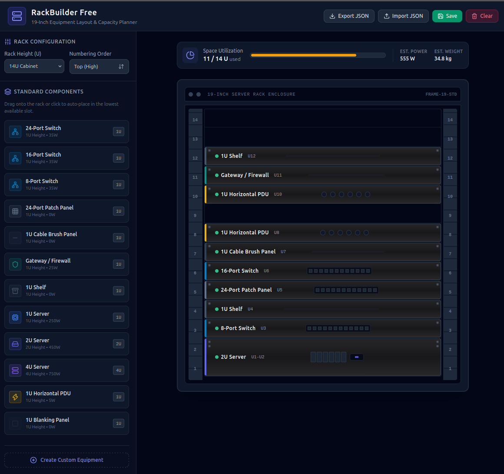

# RackBuilder Free

I have multiple times needed a simple tool for designing 19-inch rack layouts and calculating capacity. This tool is designed to help you plan your rack layouts and calculate the total power and weight of your equipment.

Disclaimer:

* This is built with AI, I will accept suggestions and improvements though.
* CSS and JS is pulled from external sources.

Will try to tag versions, so I can keep track of changes.

## Features

* Import/Export designs
* Create custom equipment from UI
* Rack height can be selected in dropdown

## Using it

It's as simple as opening the index.html file in a web browser.

You can also test it out here [https://rackbuilder.tomasnorre.dk](https://rackbuilder.tomasnorre.dk)

## Screenshot

## License

[MIT](LICENSE)